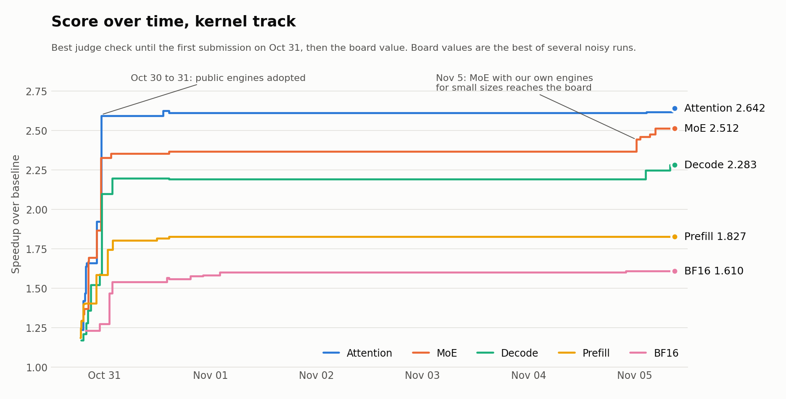

# kdev

A toolkit that lets AI coding agents write and optimize GPU kernels with measurements you can trust.

Agents are good at trying ideas and bad at noticing when their benchmark is wrong. `kdev` gives them one command-line interface for building, testing, timing and analyzing kernels on a remote GPU. Its timing reproduces the conditions of the target judge by default, and every claim is tied to the run that backs it.

It was built with AI agents during the [Open Kernel Challenge](okc-challenge/README.md), where about 40 agents shared one NVIDIA H200, after several days of results turned out to be invalid. The causes were a cache flush done the wrong way, the wrong compiler version, timing on a single seed, and comparing ratios instead of absolute times. `kdev` now prevents each of those.

## Results

**148th of 2,014 participants (top 7.3%), while seriously pursuing only 2 of the 5 problems.** The other three mostly ran on public engines with light tuning.

| Problem we pursued | Speedup | Rank | Top | Behind the winner |
|---|---|---|---|---|
| BF16 projection | 1.610x | 43 of 1,747 | **2.5%** | **6.8%** (winner 1.728x) |
| MoE | 2.512x | 60 of 1,426 | **4.2%** | **11.7%** (winner 2.844x) |

<picture>
  <source media="(prefers-color-scheme: dark)" srcset="okc-challenge/progress/progress-dark.png">
  
</picture>

The [case study](okc-challenge/README.md) separates my own work from the public engines the submissions built on, and covers the [lessons learned](okc-challenge/LESSONS.md).

## What it does

**Timing you can compare.** Every measurement uses the pinned toolchain, a read flush of L2, CUDA graph replay, interleaved A/B with paired ratios and bootstrap confidence intervals, and an exclusive GPU lock that detects stray processes. Opting out of any of these is explicit and recorded in the result.

**Output sized for agents.** Each command prints a verdict in at most about 40 lines and ends with a run ID. Full samples, disassembly and traces go to a run directory that agents read back in pages, and `--json` returns one JSON object.

**Shared memory for many agents.** A ledger answers "has this already been tried?", a board handles claims and findings with conflict detection, and a "limit" or "dead" claim can't be closed without evidence attached.

**Safe by default.** `kdev` never submits to a judge and never compiles while holding the GPU lock.

## Example

```bash
kdev doctor --problem DIR               # check GPU, toolchain, lock
kdev ledger tried cand.py               # already measured?
kdev build cand.py                      # registers, spills, serialization warnings
kdev check cand.py                      # correctness on fresh seeds, eager and graph
kdev ab best.py cand.py                 # judge-style interleaved comparison
kdev sass cand.py --kernel RE --loops   # hot-loop instruction mix and audits
kdev note "CLAIM" --kind limit --evidence RUN_SASS,RUN_SWEEP
```

## Commands

| Area | Commands |
|---|---|
| Build and correctness | `build`, `check`, `sanitize`, `comply` |
| Timing | `time`, `ab`, `calib`, `sweep`, `ablate` |
| Analysis | `sass`, `regs`, `timeline`, `floor`, `profile`, `dispatch` |
| GPU job service | `serve`, `job`, `queue`, `lock` |
| Agent collaboration | `ledger`, `idea`, `note`, `board`, `doc`, `dashboard` |
| Remote and integration | `remote`, `sync`, `mcp` |

Problem adapters supply the reference, checks, inputs and score. Adapters exist for the Open Kernel Challenge, KernelBench and standalone CUDA files. `kdev mcp` exposes the same commands as an MCP server.

## Install

```bash
pip install -e ".[dev,mcp]"   # ledger, SASS analysis, dashboard, MCP and tests; no GPU needed
pytest
```

To install on a GPU host over SSH, run `scripts/pod_install.sh HOST PORT`.

## Documentation

- [Quickstart](docs/QUICKSTART.md): the 10 core commands in order
- [Timing protocol](docs/PROTOCOL.md): how timing works, with calibration evidence
- [Design](docs/DESIGN.md): architecture and how each past mistake became a requirement
- [Multi-agent collaboration](docs/COLLAB.md): board, claims and shared notes
- [Adapters](docs/ADAPTERS.md): adding a new problem
- [MCP server](docs/MCP.md)
