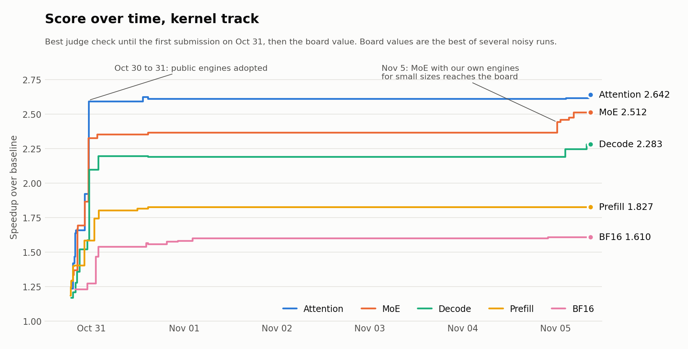

# Open Kernel Challenge: GPU kernel optimization case study

The Muse Spark Open Kernel Challenge asked 2,014 participants to speed up five inference kernels on an NVIDIA H200, using a judge that measures real speedup against a stock baseline and checks that results stay correct.

I placed **148th overall (top 7.3%)** and **43rd of 1,747 on BF16 projection**. The work was done by AI coding agents under my direction on one rented H200, using `kdev`, the toolkit in this repository, which was built for the challenge. My part was setting direction, reviewing evidence and deciding what to pursue.

## Results

<picture>
  <source media="(prefers-color-scheme: dark)" srcset="progress/progress-dark.png">
  
</picture>

| Problem | Speedup | Rank | Top |
|---|---|---|---|
| BF16 projection | 1.610x | 43 of 1,747 | 2.5% |
| MoE | 2.512x | 60 of 1,426 | 4.2% |
| Decode layer | 2.283x | 148 of 1,300 | 11.4% |
| Attention decode | 2.642x | 216 of 1,380 | 15.7% |
| Prefill layer | 1.827x | 203 of 899 | 22.6% |

These are the board values when the kernel track closed on 2026-11-05, and the organizers could still revise them. Each one is the best of several noisy runs: the same MoE file scored between 2.451 and 2.512. The data behind the chart is in [`progress/progress.csv`](progress/progress.csv).

## What's mine and what isn't

The submitted kernels build on public engines from other participants, mainly vjeux and alygg77, with my tuning on top. Adopting those engines caused the big jump on the first night. **Those submissions aren't in this repository, because they contain other people's code.**

My own work is:

- **`kdev`**, the measurement and multi-agent toolkit, built with AI agents. See the [repository README](../README.md).
- **MoE engines for small batch sizes.** Together with tuning the public engine for large sizes, they raised MoE from 2.366 to a repeat-check level of about 2.49. The sources are in [`engines/`](engines/).
- **Hardware measurements** that showed where the time was going, in [`reports/`](reports/).

## How the work ran

1. **Match the judge.** Local timing had to reproduce the judge's toolchain, cache state and replay order before any result could be trusted.
2. **Measure before designing.** Reports like the [weight-streaming limit](reports/weight-streaming-limits.md) separated hard limits from fixable overhead.
3. **Set a kill gate first.** Each design got a pass and kill threshold before it ran, so three ground-up MoE rewrites were dropped quickly. The best of them reached only 0.70x of the best file.
4. **Harden what ships.** Candidates went through poison-scratch, timeout and repeated-replay tests before submission, and independent reviewers read the source.

[`LESSONS.md`](LESSONS.md) covers what this taught me, with the numbers.

## In this folder

| Path | Contents |
|---|---|
| [`LESSONS.md`](LESSONS.md) | What went wrong and what I'd keep |
| [`engines/`](engines/) | MoE engines as shipped: `sc_h.cu` (M = 1), `x3_h.cu` (M up to 8), `x7_h.cu` (M = 8, tuned) |
| [`reports/`](reports/) | H200 measurements: [weight streaming](reports/weight-streaming-limits.md) and [compute core](reports/compute-core-limits.md) |
| [`progress/`](progress/) | Score history, and the script that draws the chart |
